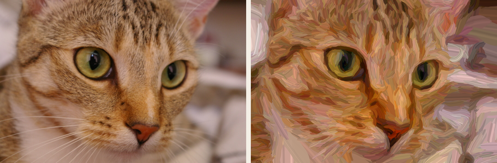

# Olieverf Studio 🎨

Flutter-app die een foto opnieuw opbouwt uit penseelstreken: eerst grote, daarna steeds fijnere. Het resultaat exporteer je als **SVG** (echte vectorvormen, één `<path>` per streek) of als PNG in hoge resolutie.



## Starten

Dit pakket bevat alleen `lib/`, `test/` en `pubspec.yaml`. De platformmappen (android/ios/macos/windows) laat je Flutter zelf aanmaken:

```bash
cd olieverf_studio
flutter create --project-name olieverf_studio --platforms=android,ios,macos,windows,linux .
flutter pub get
flutter test        # controleert engine + SVG-export
flutter run
```

### Platformnotities
- **iOS**: voeg toe aan `ios/Runner/Info.plist`:
  ```xml
  <key>NSPhotoLibraryUsageDescription</key>
  <string>Kies een foto om te schilderen.</string>
  ```
- **macOS**: in `macos/Runner/DebugProfile.entitlements` én `Release.entitlements`:
  ```xml
  <key>com.apple.security.files.user-selected.read-write</key>
  <true/>
  ```
- **Android / Windows / Linux**: niets extra nodig.

## Hoe het werkt

`lib/painter/painter_engine.dart` is puur Dart (geen Flutter), en draait in een achtergrond-isolate via `compute()`.

Per laag (4 lagen, van penseel ≈ 6% van de lange zijde tot ≈ 1%):

1. **Kleurreferentie**: de foto wordt geblurd op de schaal van het penseel.
2. **Richtingsveld**: een *structure tensor* van de helderheidsgradiënten geeft per pixel een richting langs randen en contouren. Streken volgen dus de vorm (haar, bloemblaadjes, plooien).
3. **Waar is nog werk?** Het verschil tussen deze laag en de vorige, grovere laag, genormaliseerd op het 92e percentiel. De eerste laag bedekt alles; latere lagen schilderen alleen waar detail zit.
4. **Zaaien**: een licht verspringend raster met kandidaatpunten. Een punt wordt gehouden als de fout hoog genoeg is.
5. **Streek groeien**: vanaf het zaadpunt in beide richtingen het veld volgen (met wat traagheid zodat bochten vloeiend zijn). Stoppen als de kleur eronder te veel verandert.
6. **Vorm**: de middellijn wordt een taps toelopende, licht golvende veelhoek. Daaroverheen komen twee dunne lichtere/donkerdere "penseelharen".

Per streek varieert de kleur een beetje (vibrance + jitter). Dat geeft de pastel/olieverf-look.

### Bestanden

| Bestand | Rol |
|---|---|
| `painter/models.dart` | `BrushStroke`, `Painting`, `PaintSettings` |
| `painter/image_ops.dart` | snelle gaussian blur (3× box), Sobel, percentiel |
| `painter/painter_engine.dart` | het algoritme |
| `painter/stroke_render.dart` | streken → Flutter `Path` / PNG |
| `painter/svg_export.dart` | streken → SVG (zelfde geometrie als op scherm) |
| `painter/painting_view.dart` | geanimeerde weergave (streek voor streek) |
| `painter/image_loader.dart` | foto decoderen + verkleinen |
| `main.dart` | UI |

## Stijlen en kleurmodi

| Stijl | Hoe |
|---|---|
| Olieverf | lange, gladde streken langs de vormen |
| Oliepastel | korte krijterige toetsen met penseelharen |
| Impressionisme | losse toetsen, meer kleurvariatie |
| Aquarel | transparante washes, wit papier, randjes op de fijnste laag |
| Pointillisme | alleen stippen (`<circle>` in de SVG) |
| Houtskool | monochroom, lichte delen blijven papier |
| Potlood | arceringen op toon + contourlijnen langs randen |
| Pen & inkt | kruisarcering in 4 richtingen + contouren (ideaal voor pen-plotters) |

Kleurmodi: **Kleur**, **Zwart-wit**, **Sepia**, **Cyanotypie** en **Beperkt palet** (k-means, 8 kleuren uit de foto). Bij potlood/pen geeft *Kleur* een kleurpotlood-effect. Op zwart papier tekenen ze met witte lijnen.

Alle instellingen per stijl staan in `lib/painter/styles.dart`.

## Kunstenaarskeuzes

Bovenop de penseelstreek maakt de engine keuzes zoals een schilder:

- **Focus**: één focuspunt (automatisch, of tik op het schilderij). Daaromheen meer detail, scherpe randen en kleinere streken; verder weg grotere, lossere streken en "verloren" randen.
- **Vereenvoudigen**: Kuwahara-filter (vlakken met behoud van randen) + groeperen in een paar waardes licht/midden/donker; sterker verder van de focus.
- **Warm / koel**: lichten warmer, schaduwen koeler.
- **Paletten**: Zorn (oker, vermiljoen, zwart, wit), Impressionistisch (geen zwart, violette schaduwen), Aardetinten, Nocturne.
- **Ondergrond**: olieverf start op een sienna-ondergrond met een losse omber-onderschildering die in de losse delen doorschemert (SVG-groep `onderschildering`).
- **Volgorde**: donker naar licht; reliëf (impasto) alleen op de lichten.
- **Accenten**: tot slot een paar felle lichtjes en diepe donkers bij de focus (SVG-groep `accenten`).

## Instellingen in de app

| Schuif | Effect |
|---|---|
| Penseelgrootte | alle penselen groter/kleiner |
| Detail | lager = losser en abstracter, hoger = meer fijne streken |
| Streeklengte | korte toetsen ↔ lange vegen |
| Kleurintensiteit | verzadiging |
| Kleurvariatie | willekeurige kleurafwijking per streek |
| Penseelharen | sterkte van de lichte/donkere lijntjes in streken (0 = uit) |
| 🎲 | zelfde instellingen, nieuwe willekeurige streken |

Wil je de stijl verder sturen, pas dan `_layers` aan bovenin `painter_engine.dart`: breedte, maximale lengte en drempel per laag.

## SVG-export

- `viewBox` = werkresolutie (standaard 700 px lange zijde). Omdat het vector is, schaal je naar elk formaat.
- Streken zitten gegroepeerd per laag (`<g id="laag-1">` … `laag-4`). In Illustrator, Inkscape of Figma kun je zo lagen verbergen of herkleuren.
- Typische grootte: 20–40k paden, 5–10 MB. Wil je kleiner: zet *Penseelharen* op 0 (≈ de helft minder paden) of verlaag *Detail*.

## Ideeën voor later
- Papier-/canvasstructuur: een SVG `feTurbulence`-filter over de streken (blijft vector).
- Kleurpalet beperken (k-means) voor een "echte verfdoos"-look of voor plotters.
- Voortgangsbalk via een `Isolate` met `SendPort`.
